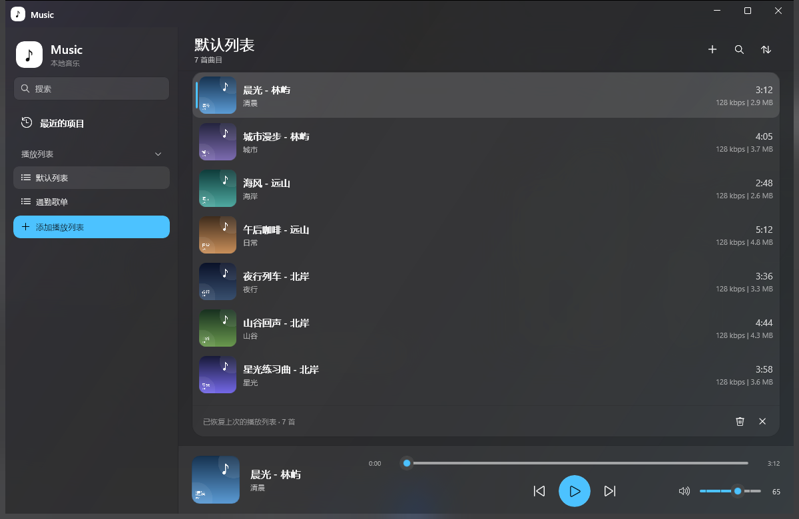
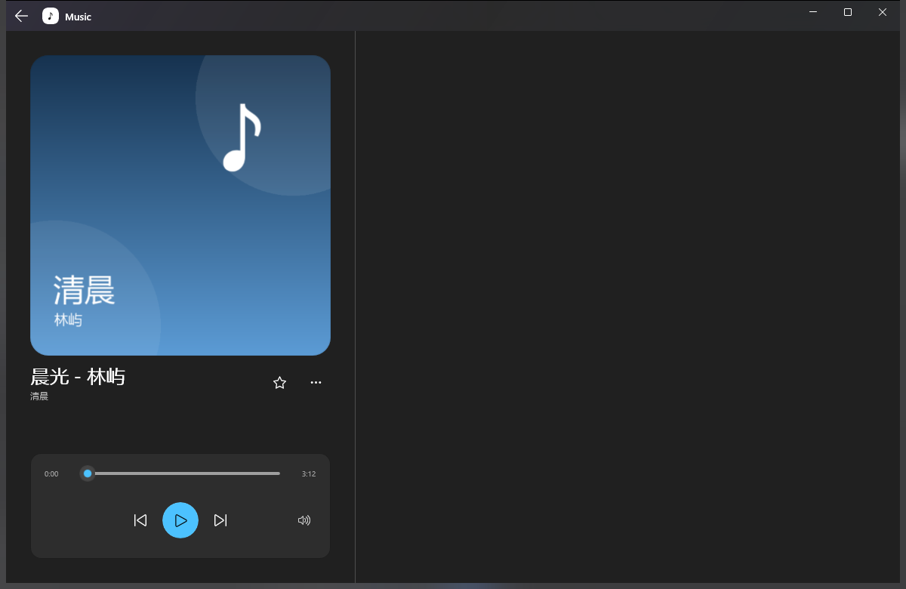
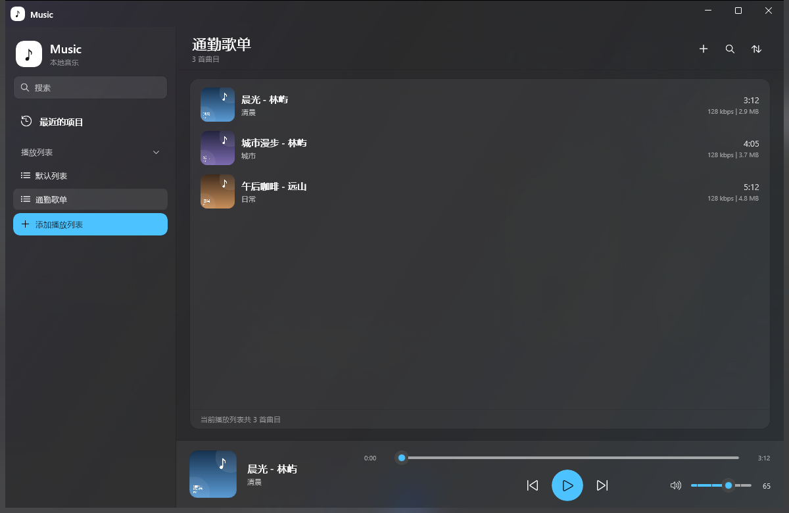

# Simple Music Player

**Alpha 0.2 · 早期测试版 - made by deepseek AI**

> [!WARNING]
> 这是 **Alpha 0.2** 早期测试版本，功能和界面仍在快速调整，可能存在崩溃、播放异常、界面错位、配置或数据不兼容等问题。
> 升级或试用前请先备份程序目录下的 `config` 和 `data`；不要把它作为唯一副本用于重要场景。

一款使用 **WinUI 3 / Windows App SDK** 编写的本地音乐播放器：Fluent 深色界面、常驻播放条、可自定义播放列表，以及接近系统播放器的完整播放控制。




## 功能

### 播放与导入

- 一次选择多个音频文件导入，支持 `mp3`、`m4a`、`m4b`、`aac`、`wav`、`flac`、`ogg`、`opus`、`wma`、`aif/aiff`、`alac`（实际解码能力取决于系统解码器）。
- 把音频文件直接拖到播放列表即可添加，可一次拖入多个文件，拖入时会显示高亮提示。
- 双击曲目播放；播放 / 暂停、上一首、下一首、拖动进度、音量调节、一键静音。
- 一首播完自动播放下一首。
- 循环播放按钮位于上一首左侧，支持 **关闭 → 列表循环 → 单曲循环** 三态切换；底部播放条和全窗口播放页各有一个，状态同步。
- 记住播放列表，下次启动恢复；文件被移动或删除时条目变灰并提示“文件缺失”，可保留或移除。
- 支持把音频文件拖到 `Music.exe` 上，或通过命令行传入文件路径启动。

### 全窗口播放页

- 点击底部播放条的空白区域或左侧歌曲信息区域，打开全窗口播放页。
- 进入播放页后隐藏底部常驻播放条，只保留大封面和控制区；返回后恢复。
- 封面随窗口大小按比例缩放；标题、专辑、收藏 / 更多按钮和播放控制尺寸固定，标题始终与封面左边缘对齐。
- 主界面与播放页之间使用黑场淡入淡出过渡。
- 点击标题栏左侧返回箭头或按 `Alt + Left` 返回。

### 播放列表

- **默认列表**：承载原始播放队列，支持导入、搜索、排序。
- **最近的项目**：自动记录最近播放的曲目（最多 50 首），文件缺失的条目变灰；提供实时搜索、按名称 / 时长 / 最近播放排序，以及带确认的清空按钮。
- **自定义播放列表**：点击“添加播放列表”在侧栏直接新建并命名；右键可重命名或删除。每个列表拥有与默认列表一致的背景、标题、计数、操作栏、曲目卡片和底部状态栏，支持加号导入、**拖拽添加**、实时搜索（只作用于当前列表）和排序。名称与歌曲路径保存在 `config\playlists.json`。
- **全局搜索**：侧栏搜索框可以直接输入，实时检索默认列表、最近项目和所有自定义播放列表。结果在右侧独立页面展示，风格与播放列表页一致，并标注每首歌所属的播放列表；按标题、艺术家、专辑或文件名匹配。双击结果播放，右键可播放、加入默认列表、加入自定义播放列表或查看详细信息。按 `Ctrl + F` 可随时聚焦搜索框，按 `Esc` 清空并返回原页面。
- 曲目行使用 56px 圆角封面和 68px 行高，标题显示“标题 - 艺术家”，下方显示专辑；悬停时整行高亮并显示播放、收藏、添加到播放列表、更多四个图标按钮。
- 默认列表、最近的项目、自定义播放列表和搜索结果共用同一套曲目行：56px 封面、14px 标题、右侧时长 / 文件信息、当前播放蓝线和悬停操作按钮，切换页面时不会跳出另一套排版。
- 正在播放的行持续显示蓝色竖线和背景高亮；点击其他曲目只会移动选择背景，不会把蓝线移到未播放的行。
- 右键曲目可播放、移除或查看详细信息。
- 排序菜单支持按名称、时长、添加日期排序。

### 界面与系统集成

- 常驻底部播放条：在默认列表、最近的项目和自定义播放列表之间切换时始终显示；仅在打开全窗口播放页时隐藏，并与页面切换一起淡入淡出。
- 底部播放条左侧展示圆角封面、歌曲标题、艺术家和专辑；右侧进度条扩展至可用宽度，循环、上一首 / 播放暂停 / 下一首按进度条区域居中，音量图标和滑块固定在右端。
- 侧栏底部固定一个“设置”按钮，打开与播放列表页同样式的设置页。
- 自定义标题栏：拖动标题栏的应用名称或空白区域移动窗口，双击最大化；播放页返回按钮出现在标题栏最左侧。
- 最小窗口尺寸限制为 `1120×720`，避免播放条控件因窗口过小而重叠。
- 统一图标：标题栏、侧栏和任务栏使用同一套白色圆角方块 + 黑色音符图标。
- 系统媒体控制（SMTC）：向 Windows 提供标题、艺术家、专辑和内嵌封面，支持系统媒体卡片的上/下一首与播放/暂停。
- 任务栏缩略图工具栏：通过 `ITaskbarList4` 图片列表尝试添加三个按钮；若当前桌面会话返回 `E_ACCESSDENIED`，自动保留系统媒体卡片作为可用入口。

### 设置

- 侧栏底部固定“设置”按钮，设置页沿用列表页的 66px 标题栏、卡片和间距，在右侧显示，不打断正在播放的音乐。
- **应用语言**：简体中文 / English 切换，切换后整个界面立即更新，选择保存在 `config\settings.json`。
- **界面主题**：跟随系统 / 浅色 / 深色三种选择，切换后立即生效，并保存到 `config\settings.json`，下次启动继续使用；标题栏按钮颜色会随主题切换。
- 设置页底部显示应用名称、**Alpha 0.2**（`0.2.0-alpha`）、WinUI 3 / .NET 10 / Windows App SDK 版本、版权信息和 GitHub 仓库链接。

### 元数据

- 优先读取 FLAC / MP3 / WAV 的内嵌标签和封面，再回退到 Windows 属性系统和 Shell 缩略图；读取不到时使用文件名。
- 每首曲目的导入时间、文件大小、最后写入时间、元数据、时长、比特率、文件类型和收藏状态保存在 `data\tracks` 下，每首一个 JSON 文件；使用路径哈希命名和原子替换写入，避免半写入损坏。
- 详细信息弹窗按固定顺序显示文件格式、比特率、文件位置、文件大小、专辑、专辑艺术家、标题、时长和专辑封面。

## 截图

| 全窗口播放页 | 自定义播放列表 |
| --- | --- |
|  |  |

## 下载与运行

> 当前源码为 **Alpha 0.2** 早期测试版。遇到问题、崩溃或界面异常，欢迎到 [Issues](../../issues) 反馈。

1. 打开本仓库的 [Releases](../../releases) 页面。
2. 下载最新的 `Music-Player-Release-win-x64.zip` 并解压到任意文件夹。
3. 双击 `Music Launcher.cmd` 启动（推荐），不要直接双击 `Music.exe`。

`Music.exe` 是单文件自包含程序，内置 .NET 10 运行时和 Windows App SDK，目标电脑不需要另外安装 .NET 或 Windows App Runtime。单文件程序运行前需要把内置运行库解压到磁盘，启动器把解压位置固定到程序目录下的 `.runtime`，避免个别环境无法写入 `%TEMP%\.net\Music`。

- 第一次通过启动器启动会生成 `.runtime`（约 198 MB），可能稍慢；之后复用缓存。
- `.runtime` 在程序退出后可删除以释放空间，下次启动会自动重建。
- 如果 `Music.exe` 双击没有反应，请使用 `Music Launcher.cmd`。
- 程序未做代码签名，从网络下载后 Windows SmartScreen 可能提示一次，选择“仍要运行”即可。

## 从源码构建

### 环境要求

- Windows 10 1809 或更高版本（推荐 Windows 11；亚克力标题栏需要 Windows 11）
- [.NET 10 SDK](https://dotnet.microsoft.com/download)
- Visual Studio 2022/2026（安装“.NET 桌面开发”和“Windows 应用开发”工作负载）或其他支持 .NET 10 + Windows App SDK 的编辑器
- NuGet 包：`Microsoft.WindowsAppSDK 1.8.260921001`、`Microsoft.Windows.SDK.BuildTools 10.0.28000.2705`

### Visual Studio

1. 打开仓库根目录的 `Music.sln`。
2. 平台选择 **x64**，把 `Music` 设为启动项目。
3. 按 `F5` 运行，或 `Ctrl + Shift + B` 构建。

### 命令行

```powershell
dotnet restore .\Music\Music.csproj
dotnet build .\Music\Music.csproj -c Debug -p:Platform=x64
```

正常构建会生成供调试使用的多文件输出，位于 `Music\bin\...`；这不是最终发布版，DLL 需要和 exe 放在一起。

如果 NuGet 无法联网，但本机已有上述包的缓存，可以改用本地缓存目录还原：

```powershell
dotnet restore .\Music\Music.csproj --source "$env:USERPROFILE\.nuget\packages"
```

### 生成单文件发布版

```powershell
powershell -NoProfile -ExecutionPolicy Bypass -File .\Music\build\publish-portable.ps1
```

脚本执行单文件自包含发布，把最终的 `Music.exe` 复制到 `Music\` 目录，并保留 `config\playlist.json`。主要发布参数：

- `PublishSingleFile=true`
- `SelfContained=true`
- `EnableCompressionInSingleFile=true`
- `IncludeAllContentForSelfExtract=true`
- `EnableMsixTooling=true`

## 使用方式

1. 点击顶部的 **导入** 图标，多选本地音频文件；也可以直接把音频文件拖到播放列表区域。
2. 双击曲目或右键选择 **播放**。
3. 底部播放条可以播放 / 暂停、切歌、拖动进度；音量以 5 为单位变化，并显示当前数值。
4. 点击音量滑块左侧的喇叭图标可静音，再次点击恢复。
5. 点击底部播放条的空白区域或左侧歌曲信息区域，打开全窗口播放页；用标题栏返回箭头或 `Alt + Left` 返回。
6. 播放页的星星按钮切换空心 / 实心收藏图标；队列行内的星星会保存收藏状态。
7. 在队列曲目上右键，可以播放、移除或查看详细信息；行内四个图标按钮也提供相同入口。
8. 侧栏顶部的搜索框可直接输入，实时搜索所有播放列表，结果在右侧“搜索”页展示；`Ctrl + F` 聚焦搜索框，`Esc` 清空并返回原页面。
9. 点击排序图标可选择按名称、时长或添加日期排序。
10. 左侧栏可切换 **最近的项目 / 默认列表 / 自定义播放列表**；底部播放条常驻显示。
11. 点击 **添加播放列表** 在侧栏直接新建并命名；右键条目可重命名或删除。自定义列表页面支持加号导入，也可以直接把音频文件拖进去。
12. 队列会自动保存，下次启动自动恢复；文件缺失时会弹出询问框，可保留灰色条目或从列表移除。
13. 点击侧栏底部的 **设置** 可切换界面主题（跟随系统 / 浅色 / 深色）和查看版本信息；设置会保存，下次启动继续使用。

### 快捷键

| 快捷键 | 功能 |
| --- | --- |
| `Ctrl + O` | 导入音乐 |
| `Ctrl + F` | 聚焦全局搜索框 |
| `Space` | 播放 / 暂停 |
| `Alt + Left` | 从全窗口播放页返回 |
| `Esc`（搜索框） | 清空搜索并返回原页面 |
| 双击队列曲目 | 播放该曲目 |

## 目录结构

```text
Music-Player-GitHub/
├─ Music.sln
├─ README.md
├─ Music/
│  ├─ Music.csproj
│  ├─ Music Launcher.cmd            # 固定解压目录的启动器
│  ├─ src/
│  │  ├─ App.xaml / App.xaml.cs     # 应用入口与启动异常日志
│  │  ├─ Views/
│  │  │  ├─ MainWindow.xaml        # 播放器界面
│  │  │  ├─ MainWindow.xaml.cs     # 播放、队列、页面切换
│  │  │  ├─ MainWindow.Playlists.cs# 播放列表与拖拽导入
│  │  │  ├─ MainWindow.Search.cs   # 全局搜索索引与结果页
│  │  │  └─ MainWindow.Settings.cs # 设置页、主题切换与版本信息
│  │  ├─ Models/
│  │  │  ├─ Track.cs               # 曲目模型
│  │  │  ├─ SearchResult.cs        # 搜索结果行
│  │  │  ├─ RepeatMode.cs          # 循环播放模式
│  │  │  └─ ThemePreference.cs     # 跟随系统 / 浅色 / 深色
│  │  └─ Services/
│  │     ├─ AppPaths.cs            # 程序/config/logs 路径解析
│  │     ├─ AppSettingsStore.cs    # 主题与语言设置持久化
│  │     ├─ MusicLibrary.cs        # 元数据与封面读取
│  │     ├─ EmbeddedMetadataReader.cs
│  │     ├─ TrackDataStore.cs      # 每首曲目的持久化数据
│  │     ├─ PlaylistStore.cs       # 默认队列持久化
│  │     ├─ PlaylistCatalogStore.cs# 自定义播放列表持久化
│  │     ├─ RecentStore.cs         # 最近播放持久化
│  │     ├─ WindowMinSizeService.cs
│  │     ├─ TaskbarThumbnailService.cs
│  │     └─ DwmThumbnailService.cs
│  ├─ Assets/                      # 图标与文档截图
│  ├─ build/
│  │  ├─ publish-portable.ps1      # 单文件发布脚本
│  │  └─ organize-language.ps1     # 多文件构建时的语言目录整理
│  └─ config/
│     └─ app.manifest              # 应用清单
```

运行时会在程序目录下自动生成 `config\`、`data\` 和 `logs\`：

- `config\playlist.json`：默认播放队列。
- `config\playlists.json`：自定义播放列表名称和歌曲路径。
- `config\recent.json`：最近播放的曲目路径。
- `config\settings.json`：界面主题与应用语言设置。
- `data\tracks\<sha256(path)>.json`：每首曲目的导入时间、文件参数、元数据与收藏状态。
- `logs\startup-error.log`：启动异常日志。

> 这些文件属于本地用户数据，已加入 `.gitignore`，不会被提交到仓库。

## 技术说明

- 音频播放基于 `Windows.Media.Playback.MediaPlayer`，界面使用自定义传输栏控制播放。
- 文件导入使用 `FileOpenPicker`；拖拽导入使用 `DragDrop` 与 `StandardDataFormats.StorageItems`。
- 元数据和封面优先由 `EmbeddedMetadataReader` 直接解析 FLAC / MP3 / WAV 的内嵌标签和图片，再回退到 `StorageFile.Properties.GetMusicPropertiesAsync()` 和 `GetThumbnailAsync(ThumbnailMode.MusicView)`。
- 发布版使用单文件自包含发布，把 .NET 运行时、Windows App SDK 和 WinUI 资源都打进 `Music.exe`。运行时由单文件宿主解压到临时目录，因此不能把 DLL 手工拆到 `lib`、`native` 等子目录，否则会破坏 Windows 的 DLL 和 WinUI 资源加载规则。
- 默认播放列表优先保存在程序旁边的 `config\playlist.json`；如果该位置不可写，则回退到 `%LOCALAPPDATA%\Music\playlist.json`。旧版遗留在 exe 旁边的 `playlist.json` 也会被兼容读取。
- 自定义播放列表目录保存在 `config\playlists.json`，最近播放路径保存在 `config\recent.json`，界面设置保存在 `config\settings.json`。
- 主题通过 `RootGrid.RequestedTheme` 在运行时切换，标题栏按钮颜色通过 `AppWindow.TitleBar` 同步更新；主题保存在 `config\settings.json`，启动时在创建窗口后立即应用。
- 启动异常日志写在程序旁边的 `logs\startup-error.log`。
- 单文件发布已内置全部语言资源，因此发布目录中没有 `language` 文件夹；`build\organize-language.ps1` 只用于普通多文件构建时的输出整理。

## 已知限制

> **Alpha 0.2** 是早期测试版本，以下只是已知问题的一部分，可能还有未列出的缺陷。

- 功能、界面和配置文件格式仍可能调整，升级前请备份 `config` 和 `data`。
- 任务栏缩略图工具栏在部分 Windows 11 桌面会话会返回 `E_ACCESSDENIED`，此时使用系统媒体卡片（SMTC）作为可用入口。
- 随机播放尚未实现；循环播放支持列表循环和单曲循环。
- 应用语言目前支持简体中文和英语两种；切换主题时系统 Acrylic 背景由 Windows 提供，个别系统版本可能与页面主题略有差异。
- 内置“默认列表”暂不支持重命名 / 删除，只有自定义播放列表支持。
- 尚未提供自动更新，需要手动下载新版本覆盖。

## 排查

如果双击 `Music.exe` 没反应，通常是 Windows 阻止单文件程序在 `%TEMP%\.net\Music` 创建解压缓存（错误代码 5），不是播放器代码崩溃。

- 改用 `Music Launcher.cmd` 启动，它通过 `DOTNET_BUNDLE_EXTRACT_BASE_DIR` 把解压目录指向 `Music\.runtime`。
- 仍无法启动时，关闭所有 Music 进程，删除 `Music\.runtime` 后重试。
- 如果系统盘空间不足，先释放空间；解压缓存约 198 MB。

## 许可证

本项目使用 MIT License，详见 [LICENSE](LICENSE)。
